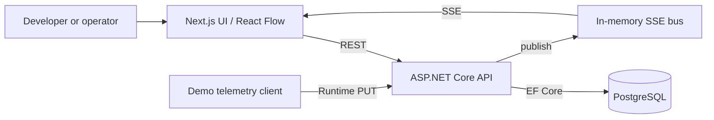

# Architecture

One Git monorepo contains a Next.js frontend and an ASP.NET Core 10 backend. The backend is a modular monolith: Domain defines the model, Application contains impact traversal and the live event port, Infrastructure implements an in-memory event bus, Persistence implements EF Core/PostgreSQL, and API composes services and HTTP use cases. PostgreSQL is the source of truth. The topology query joins current components, dependencies, successful deployment versions, and runtime states into a UI DTO.

Edges point from a dependent to the component it needs. The impact engine traverses edges in reverse and tracks visited nodes, so cycles terminate and each dependent appears once. It reports potential impact only.

SSE is scoped to a project and environment. It is in-memory, so multiple API instances would require a shared transport and replay or refetch strategy. The browser refetches on initial SSE connection; while disconnected the UI still supports manual refresh. The telemetry boundary is the runtime update API; no external telemetry provider is connected yet.

The monolith keeps the five-person team's integration and local development simple while preserving clear boundaries for future source-control, deployment, and telemetry adapters.
