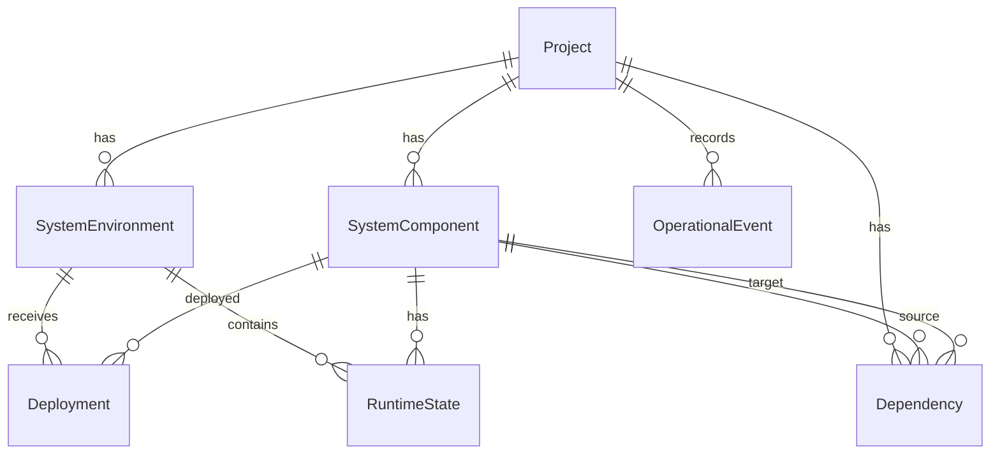

# Domain model

- **Project** owns environments, components, dependencies, deployments, runtime states, and events.
- **SystemEnvironment** identifies an execution context (Development, Testing, Staging, Production, or Custom).
- **SystemComponent** is one topology node. Types include Frontend, Service, Database, MessageBroker, Cache, ExternalService, Gateway, Worker, and Other.
- **Dependency** is a directed `source → target` relation meaning source depends on target. Source provenance can be Declared, Discovered, or Observed.
- **Deployment** records a version and status for a component in an environment.
- **RuntimeState** is the latest health and metrics for one component in one environment.
- **OperationalEvent** is a timestamped lifecycle or monitoring event, optionally tied to a component and environment.

Names are unique within a project for environments and components. A dependency may not self-reference or cross projects. `(SourceComponentId, TargetComponentId, Type)` and `(EnvironmentId, ComponentId)` for runtime state are unique. Timestamps use UTC `DateTimeOffset`.
