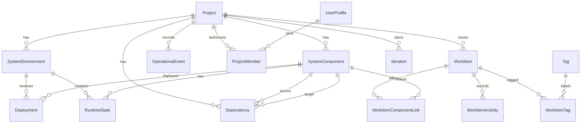

# Domain model

Version 2 projects have a unique URL-friendly slug, Private or Internal visibility, optional creator ID until identity is linked, and an optional archive timestamp. Archiving hides a project from the default list without deleting its environments, topology, deployments, or events. A newly created project has no seeded components; only the deterministic Commerce Demo seed supplies demo topology.

WorkItem, Iteration, and WorkItemActivity extend the project model. WorkItem uses a GUID key and database-backed global sequence number. Its parent, assignee, and iteration are validated within the project; activity records describe creation, updates, state changes, and assignment changes.
ProjectMember connects OIDC-backed UserProfile records to projects. Tags attach to work items through WorkItemTag. WorkItemComponentLink connects planning items to operational components within the same project; link changes are recorded in WorkItemActivity.

- **Project** owns environments, components, dependencies, deployments, runtime states, and events.
- **SystemEnvironment** identifies an execution context (Development, Testing, Staging, Production, or Custom).
- **SystemComponent** is one topology node. Types include Frontend, Service, Database, MessageBroker, Cache, ExternalService, Gateway, Worker, and Other.
- **Dependency** is a directed `source → target` relation meaning source depends on target. Source provenance can be Declared, Discovered, or Observed.
- **Deployment** records a version and status for a component in an environment.
- **RuntimeState** is the latest health and metrics for one component in one environment.
- **OperationalEvent** is a timestamped lifecycle or monitoring event, optionally tied to a component and environment.

Names are unique within a project for environments and components. A dependency may not self-reference or cross projects. `(SourceComponentId, TargetComponentId, Type)` and `(EnvironmentId, ComponentId)` for runtime state are unique. Timestamps use UTC `DateTimeOffset`.
